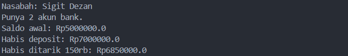

# TUGAS-1
# Java OOP: Bank Account Management

## 📖 Tentang Aplikasi

Aplikasi ini merupakan latihan Java untuk memahami pengelolaan data rekening dan nasabah menggunakan konsep class, object, method, serta array.

Program mensimulasikan proses sederhana pada rekening bank, mulai dari menyimpan informasi nasabah hingga melakukan perubahan saldo.

## ✨ Fitur yang Tersedia

- Menyimpan identitas nasabah.
- Mengelola beberapa rekening milik nasabah.
- Menyimpan beberapa nasabah di dalam bank.
- Melihat saldo awal rekening.
- Melakukan deposit atau penambahan saldo.
- Melakukan withdrawal atau pengurangan saldo.
- Menampilkan informasi jumlah rekening dan nasabah.

## 🗂️ Struktur Source Code

| File Java       | Kegunaan                                   |
| --------------- | ------------------------------------------ |
| `Account.java`  | Menangani saldo dan transaksi rekening.    |
| `Customer.java` | Menyimpan nama nasabah dan array rekening. |
| `Bank.java`     | Mengelola kumpulan objek nasabah.          |
| `Main.java`     | Menjalankan program dan menampilkan hasil. |

## 🧩 Penerapan Materi

### Class dan Object

Setiap class memiliki fungsi tertentu. Object dibuat berdasarkan class tersebut untuk menyimpan data dan menjalankan method.

### Encapsulation

Atribut seperti `balance`, `firstName`, dan `lastName` menggunakan modifier `private`. Nilainya diakses melalui method yang tersedia.

### Array

Array `Account[]` digunakan untuk menyimpan beberapa rekening, sedangkan `Customer[]` digunakan untuk menyimpan beberapa nasabah.

### Constructor

Constructor memberikan nilai awal pada object ketika dibuat, misalnya nama nasabah dan saldo rekening.

### Method

Method `deposit()` menambah saldo, `withdraw()` mengurangi saldo, dan `getBalance()` mengambil informasi saldo rekening.

## ⚙️ Persiapan dan Eksekusi

Pastikan Java JDK sudah terpasang. Simpan semua file dalam satu folder, kemudian buka terminal dan jalankan:

```bash
javac *.java
java Main
```

## 💰 Contoh Hasil Eksekusi

```text
Nasabah: Sigit Dezan
Punya 2 akun bank.
Saldo awal: Rp5000000.0
Habis deposit: Rp7000000.0
Habis ditarik 150rb: Rp6850000.0
```

Saldo berubah sesuai transaksi yang dilakukan pada `Main.java`.

## 📷 Dokumentasi Output

Screenshot terminal setelah program dijalankan:


